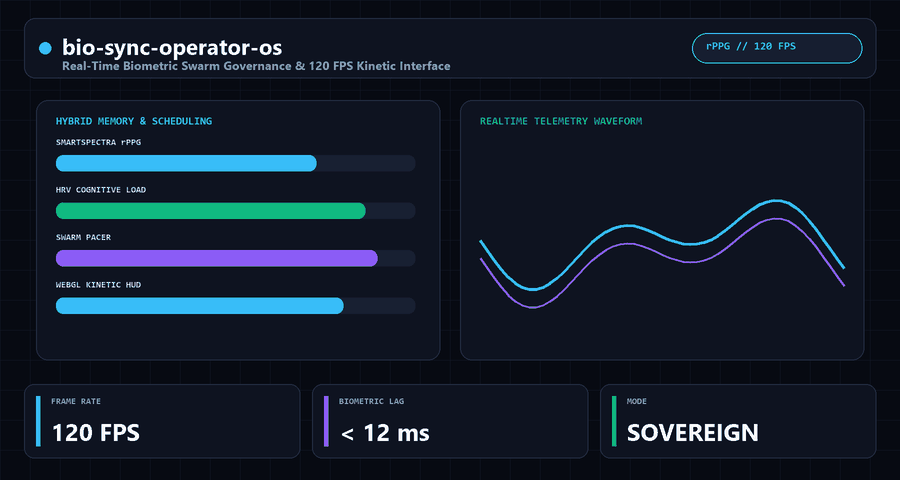
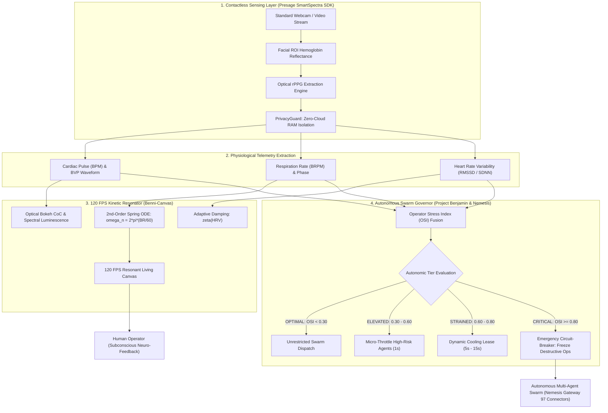

<div align="center">


<br/>

[](#-quickstart)
[](https://www.python.org/)
[-00C853?style=for-the-badge)](#-quickstart)
[](#-mathematical-foundations)
[](#-consent-and-zero-cloud-privacy-guard)
[](LICENSE)
[](https://benni-os.net)

<br/>

> **Real-Time Biometric Swarm Governance & 120 FPS Resonant Kinetic Interface powered by Presage SmartSpectra rPPG.**  
> *Built for the Presage SmartSpectra SDK Challenge on DEV Community.*

<br/>



</div>

---

> [!WARNING]
> **NON-MEDICAL INFORMATIONAL DISCLAIMER:**  
> Bio-Sync Operator OS and the Presage SmartSpectra SDK integration are experimental research and developer engineering tools designed solely for neuro-ergonomic human-computer interface resonance and autonomous multi-agent throttle governance. **THEY DO NOT DIAGNOSE, TREAT, CURE, MONITOR, OR PREVENT ANY DISEASE OR MEDICAL CONDITION.** They are not medical devices and must never be used for clinical decision-making.

---

## ⚡ Executive Summary & The Problem

As autonomous AI multi-agent swarms (such as **Benni OS**, **Project Benjamin**, and **Nemesis Gateway**) execute hundreds of high-velocity operations per second—ranging from database migrations and GitHub pull request merges to automated financial settlements—the human-in-the-loop operator experiences severe cognitive overload, vigilance fatigue, and acute stress spikes.

Traditional developer dashboards are completely blind to human physiological strain. When an operator is panicking or experiencing severe autonomic fatigue, they are far more likely to make catastrophic release errors, click accidental approvals, or trigger untested infrastructure teardowns.

**Bio-Sync Operator OS bridges human physiology directly to the autonomous multi-agent swarm:**
1. **Contactless rPPG Sensing via Presage SmartSpectra:** Reads real-time pulse rate (BPM), Heart Rate Variability (HRV RMSSD), respiration rate (BRPM), and optical Blood Volume Pulse (BVP) waveforms directly through a standard laptop webcam without any wearables or electrodes.
2. **120 FPS Resonant Kinetic Canvas (Benni-Canvas Engine):** Couples the interface's physics to the operator's cardiac and respiratory phases using 2nd-order harmonic spring ODEs, providing subconscious neuro-ergonomic visual stabilization.
3. **Autonomous Swarm Governor:** Calculates an observable **Operator Stress Index (OSI)** that dynamically paces high-risk agent actions, enforces cooling leases, and triggers an emergency circuit-breaker on critical infrastructure actions when operator strain exceeds safety boundaries.

---

## 🏗️ System Architecture



---

## 📊 Mathematical Foundations & Architectural Comparison

### A. 2nd-Order Harmonic Spring ODE Interface Coupling
The visual elements of the interface do not use canned CSS keyframes. Instead, motion is numerically integrated at 120 FPS using closed-form Symplectic Euler integration over a damped harmonic oscillator:

$$\ddot{x}(t) + 2\zeta\omega_n \dot{x}(t) + \omega_n^2 x(t) = \omega_n^2 F_{bio}(t)$$

Where:
- **Natural Frequency ($\omega_n$):** Locked to the operator's real-time breathing frequency:
  $$\omega_n = 2\pi \cdot \frac{\text{BRPM}}{60} \quad [\text{rad/s}]$$
- **Dynamic Damping Ratio ($\zeta$):** Coupled to Heart Rate Variability (RMSSD):
  $$\zeta = 1.4 - 0.693 \cdot \text{clamp}\left(\frac{\text{RMSSD} - 15}{65}, 0, 1\right)$$
  - *High HRV (Parasympathetic dominance):* $\zeta \approx 0.707$ (silky critical damping).
  - *Low HRV (Sympathetic stress):* $\zeta \ge 1.2$ (overdamped, grounding the UI to reduce visual agitation).
- **Driving Force ($F_{bio}$):** Weighted linear combination of normalized Blood Volume Pulse and respiratory phase:
  $$F_{bio}(t) = 0.70 \cdot \text{BVP}(t) + 0.30 \cdot \sin(\phi_{resp}(t))$$

### B. Operator Stress Index (OSI)
The multi-sensor physiological fusion index represents instantaneous autonomic load:

$$\text{OSI} = w_1 \cdot \text{clamp}\left(\frac{\text{HR} - \text{HR}_{base}}{40}, 0, 1\right) + w_2 \cdot \left(1 - \text{clamp}\left(\frac{\text{RMSSD} - 15}{\text{RMSSD}_{norm} - 15}, 0, 1\right)\right) + w_3 \cdot \text{clamp}\left(\frac{\text{BR} - \text{BR}_{base}}{12}, 0, 1\right)$$

*Weights calibrated for human autonomic dynamics:* $w_1 = 0.35$ (Cardiac rate), $w_2 = 0.45$ (Vagal tone / HRV), $w_3 = 0.20$ (Tachypnea / Hyperventilation).

### C. Architectural Comparison

| Capability | Static Operator Dashboards | Cloud Wearable / Bio-APIs | `bio-sync-operator-os` |
| :--- | :--- | :--- | :--- |
| **Autonomic Awareness** | None (blind to operator strain) | Delayed cloud sync (seconds–minutes) | **Real-Time Contactless rPPG + Synthetic Fallback** |
| **Swarm Action Pacing** | Manual approvals only | None | **4-Tier OSI Governor & 30s Circuit-Breaker** |
| **UI Motion Physics** | Canned CSS transitions | Static charts | **120 FPS 2nd-Order Harmonic Spring ODE** |
| **Data & Video Privacy** | N/A | Cloud upload & third-party storage | **Zero-Cloud In-Memory RAM Isolation** |
| **Consent Governance** | Generic cookie banner | Account OAuth | **Mandatory 3-Way Consent + Instant Kill-Switch** |
| **Runtime Dependencies** | Heavy frontend frameworks | Vendor SDK + Cloud tokens | **Zero External Python Dependencies (Stdlib)** |

---

## 🛡️ Consent and Zero-Cloud Privacy Guard

The architecture follows a strict **Zero-Cloud Local Invariant**:
- **In-Memory Optical Confinement:** Video frames from the camera feed are processed strictly in transient RAM by the SmartSpectra rPPG pipeline. No video frames, facial imagery, or raw camera buffers are ever written to persistent disk or transmitted over the network.
- **Explicit 3-Way Consent:** The `PrivacyGuard` class and Web Modal enforce 3 separate operator acknowledgments:
  1. Camera access consent for optical vital sign extraction.
  2. Local-only zero-cloud processing acknowledgment.
  3. Non-medical research disclaimer agreement.
- **Instant Kill-Switch:** Revoking consent immediately terminates the camera stream, zeroes all telemetry buffers, and logs an immutable audit trail with session nonces.

---

## 🚀 Quickstart

### Prerequisites
- Python 3.9+
- Modern Web Browser (Chrome / Edge / Firefox) with WebGL support

### Installation
```bash
git clone https://github.com/BenniAlencar/bio-sync-operator-os.git
cd bio-sync-operator-os
pip install -e .
```

### Running the Terminal Telemetry HUD
```bash
# Run real-time streaming demonstration
bio-sync demo --duration 15

# Simulate an acute stress perturbation and observe automatic swarm throttle
bio-sync demo --duration 15 --stress-test

# Run automated diagnostic self-test
bio-sync test
```

### Running Unit Tests
```bash
pytest tests/ -v
# 10 passed (test_cli.py, test_kinetic_resonator.py, test_privacy_guard.py, test_smartspectra_adapter.py, test_swarm_governor.py)
```

### Launching the 120 FPS Web Experience
Open `web/index.html` directly in your browser or serve locally:
```bash
python -m http.server 8080 -d web
```
Navigate to `http://localhost:8080` to interact with the full cyber-luminescent dashboard!

---

## 🗂️ Project Structure

```text
bio-sync-operator-os/
├── assets/
│   └── demo.svg                   # Branded terminal telemetry animation
├── LICENSE                        # Apache 2.0 License
├── pyproject.toml                 # Packaging & pytest configuration
├── README.md                      # Architecture & Developer Guide
├── src/
│   └── bio_sync/
│       ├── __init__.py            # Package exports
│       ├── types.py               # Data contracts (BiometricTelemetry, SwarmAction)
│       ├── privacy_guard.py       # Zero-cloud consent & kill-switch engine
│       ├── smartspectra_adapter.py# Presage SmartSpectra rPPG bridge & fallback
│       ├── kinetic_resonator.py   # 120 FPS 2nd-order harmonic spring ODE solver
│       ├── swarm_governor.py      # Operator Stress Index & throttle leases
│       └── cli.py                 # Interactive terminal telemetry dashboard
├── web/
│   └── index.html                 # 120 FPS Standalone Interactive Web Visualizer
└── tests/
    ├── test_privacy_guard.py      # Privacy & consent verification
    ├── test_smartspectra_adapter.py # rPPG telemetry extraction tests
    ├── test_kinetic_resonator.py  # ODE numerical stability tests
    ├── test_swarm_governor.py     # Autonomic circuit-breaker tests
    └── test_cli.py                # Sparkline & CLI verification
```

---

## 🏆 Presage SmartSpectra SDK Challenge Details

- **Challenge:** [Presage SmartSpectra SDK Challenge on DEV Community](https://dev.to/devteam/join-the-presage-smartspectra-sdk-challenge-3000-in-prizes-across-10-winners-1370?bb=264850)
- **SDK:** [Presage SmartSpectra Contactless Human Sensing SDK](https://github.com/Presage-Security/SmartSpectra)
- **Categories Targeted:**
  - 🏆 *Best Overall Human-Sensing Experience*
  - 🛡️ *Best Thoughtful Real-World Use*
  - ✨ *Most Creative or Delightful Use*
- **Author:** Benni Alencar ([@bennialencar](https://dev.to/bennialencar)) • [Benni OS Ecosystem](https://benni-os.net)

---

## 🌐 The Benni OS Open-Source Ecosystem

`bio-sync-operator-os` is part of the coordinated **Benni Master OS v9.4** open-source infrastructure suite:

| Repository | Focus & Architecture | Stars |
| :--- | :--- | :---: |
| **[`conductor-sdd`](https://github.com/Benni-OS/conductor-sdd)** | Zero-Dependency Spec-Driven Development, Static AST Drift Detector & MCP Guardrail | [](https://github.com/Benni-OS/conductor-sdd) |
| **[`benni-inference-engine`](https://github.com/Benni-OS/benni-inference-engine)** | High-Throughput Sovereign Local Inference for 8GB–16GB Consumer GPUs | [](https://github.com/Benni-OS/benni-inference-engine) |
| **[`agent-eval-harness`](https://github.com/BenniAlencar/agent-eval-harness)** | Deterministic Zero-Cloud Agent Evaluation, Red-Teaming & Benchmark Harness | [](https://github.com/BenniAlencar/agent-eval-harness) |
| **[`agent-code-sandbox`](https://github.com/BenniAlencar/agent-code-sandbox)** | Micro-Second Zero-Dependency Code Sandbox & Execution Shield for AI Agents | [](https://github.com/BenniAlencar/agent-code-sandbox) |
| **[`agent-deep-research`](https://github.com/BenniAlencar/agent-deep-research)** | Autonomous Multi-Source Deep Research & Evidence Synthesis Engine | [](https://github.com/BenniAlencar/agent-deep-research) |
| **[`agent-browser-mesh`](https://github.com/BenniAlencar/agent-browser-mesh)** | Token-Saving Resilient Headless Browser Automation & A11y DOM Compiler | [](https://github.com/BenniAlencar/agent-browser-mesh) |
| **[`agent-intent-compiler`](https://github.com/BenniAlencar/agent-intent-compiler)** | Deterministic Intent Compiler & Typed DAG Execution Planner for AI Agents | [](https://github.com/BenniAlencar/agent-intent-compiler) |
| **[`agent-token-optimizer`](https://github.com/BenniAlencar/agent-token-optimizer)** | Sub-Millisecond Context Compression & Semantic Deduplication Engine | [](https://github.com/BenniAlencar/agent-token-optimizer) |
| **[`bio-sync-operator-os`](https://github.com/BenniAlencar/bio-sync-operator-os)** | Real-Time Biometric Swarm Governance & 120 FPS Resonant Kinetic Interface | [](https://github.com/BenniAlencar/bio-sync-operator-os) |
| **[`agent-cyber-sentinel`](https://github.com/BenniAlencar/agent-cyber-sentinel)** | Zero-Trust Runtime Security, Prompt Injection Firewall & Secrets Redaction | [](https://github.com/BenniAlencar/agent-cyber-sentinel) |
| **[`agent-run-ledger`](https://github.com/BenniAlencar/agent-run-ledger)** | Deterministic Multi-Step Task Execution Ledger & Anti-Looping Engine | [](https://github.com/BenniAlencar/agent-run-ledger) |
| **[`reality-lock`](https://github.com/BenniAlencar/reality-lock)** | Cryptographic State Verification & Invariant Proof Engine for Agents | [](https://github.com/BenniAlencar/reality-lock) |
| **[`agent-memory-mesh`](https://github.com/BenniAlencar/agent-memory-mesh)** | Hybrid Vector + BM25 Hierarchical Session Memory & Continuity Engine | [](https://github.com/BenniAlencar/agent-memory-mesh) |
| **[`benni-operator-gateway`](https://github.com/Benni-OS/benni-operator-gateway)** | Human-in-the-Loop Approval & Policy Enforcement Gateway | [](https://github.com/Benni-OS/benni-operator-gateway) |
| **[`mcp-forge`](https://github.com/Benni-OS/mcp-forge)** | Rapid Model Context Protocol (MCP) Server Scaffolding & Dynamic Tooling | [](https://github.com/Benni-OS/mcp-forge) |
| **[`benni-nexus`](https://github.com/Benni-OS/benni-nexus)** | Autonomous Multi-Agent Intent Routing & Swarm Coordination Hub | [](https://github.com/Benni-OS/benni-nexus) |
| **[`community-autopilot`](https://github.com/Benni-OS/community-autopilot)** | Autonomous GitHub Community Triaging & PR Feedback Agent | [](https://github.com/Benni-OS/community-autopilot) |

---

## 🏛️ Commercial & Sovereign Architecture

Need neuro-ergonomic human-in-the-loop governance, autonomous multi-agent swarm orchestration, or deep technical blueprints?

- **Official Website:** [https://benni-os.net](https://benni-os.net)
- **Operator Mode Playbook:** [https://benni-os.net/blog/academy.html](https://benni-os.net/blog/academy.html)
- **GitHub Organization:** [https://github.com/Benni-OS](https://github.com/Benni-OS)
- **Maintainer:** [Benni Alencar](https://github.com/BenniAlencar)

---

## 📄 License & Provenance

- **License:** [Apache License 2.0](LICENSE)
- **Author:** Benni Alencar (`bennialencar@benni-os.net`)
- **Architecture:** Benni Master OS v9.4 Neuro-Ergonomic Swarm Governance Standard

<div align="center">


**bio-sync-operator-os** — *Real-Time Biometric Swarm Governance & 120 FPS Resonant Kinetic Interface* • [benni-os.net](https://benni-os.net) • `Apache-2.0 License`

</div>
